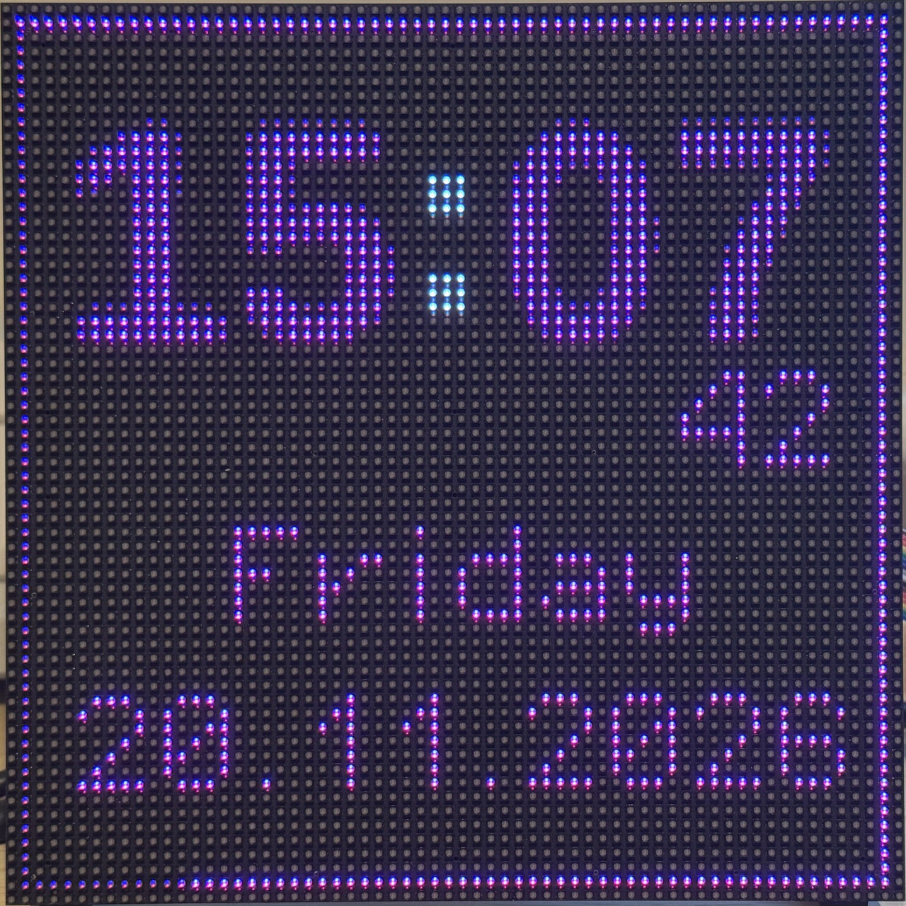
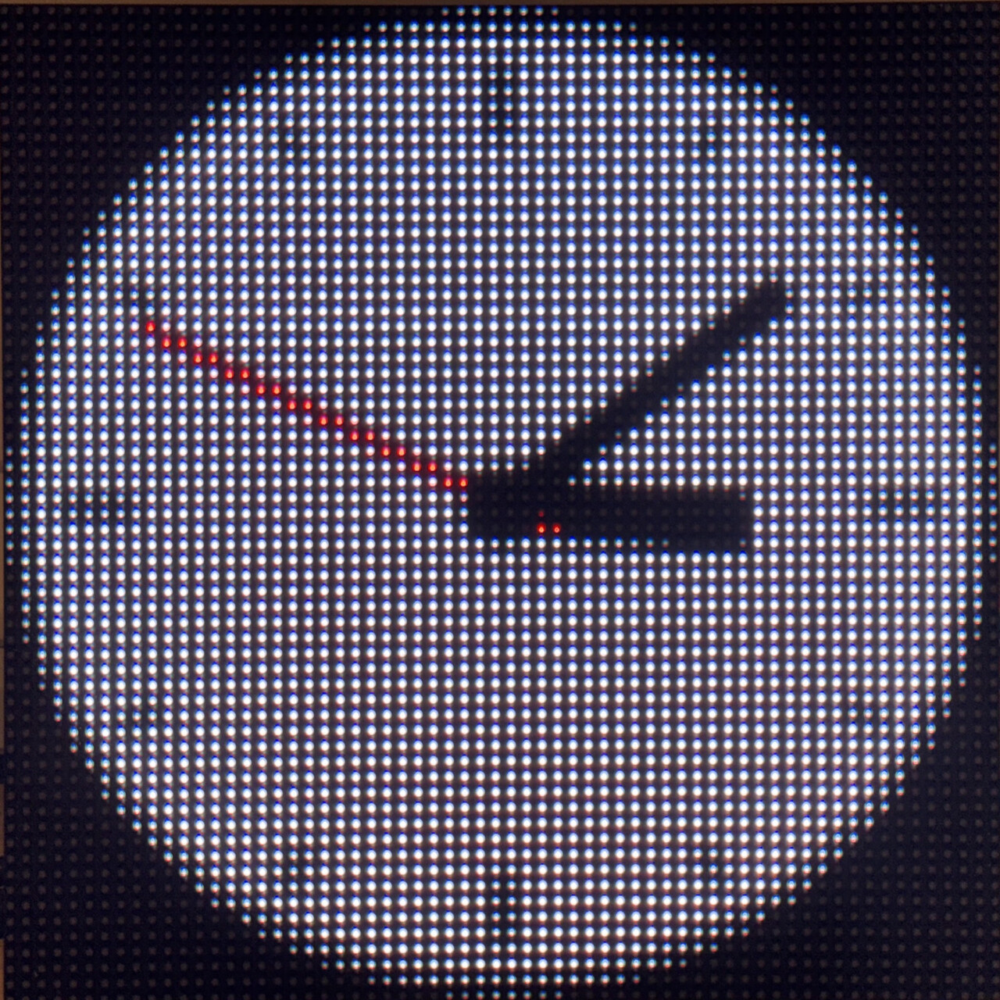
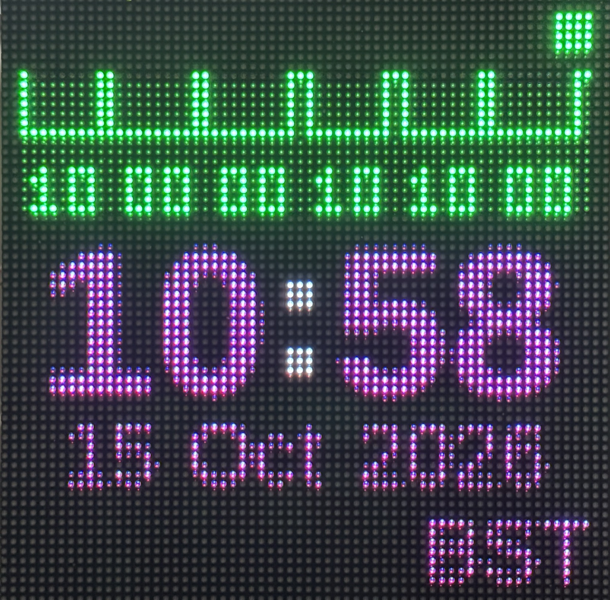

# sk-radio-clock

An Embedded Swift clock for the **Raspberry Pi Pico 2 W (RP2350)** and a **64 × 64 HUB75 RGB LED panel**. The default Wi-Fi/NTP configuration offers analogue and digital clock faces. [Optional MSF radio timekeeping](#optional-msf-radio-timekeeping) adds an analytical face and requires a separate receiver for the UK's 60 kHz time signal.

| Digital face | Analogue face |
| --- | --- |
|  |  |

The aim is to make motion and shapes look smooth on a 64 × 64 LED grid. The digital face shows this along its border. As the seconds indicator travels around the perimeter, the leading LED brightens gradually between whole-pixel steps. Antialiased edges and alpha compositing bring the same care to the clock faces. See the [graphics guide](docs/graphics.md) for how the renderer does it.

## Getting started

You need a **Pico 2 W** (`pico2_w`), a compatible 64 × 64 HUB75 panel with a suitable power supply, a USB data cable, and access to a 2.4 GHz WPA2-Personal network and an NTP server. Follow the [HUB75 wiring and power notes](#hub75-hardware). The older RP2040 Pico W (`pico_w`) is outside this project's supported boards.

1. Install the [build tools](#build-requirements). If you are building without the Pico VS Code helper, set the [SDK and toolchain paths](#build-and-toolchain-details). Clone the repository and create your local configuration.

   ```sh
   git clone https://github.com/stinky-kitten/sk-radio-clock.git
   cd sk-radio-clock
   test -e Config/WiFiCredentials.swift || \
     cp Config/WiFiCredentials.swift.example Config/WiFiCredentials.swift
   ```

2. Edit `Config/WiFiCredentials.swift`. Set `WiFiCredentials.ssid` and `WiFiCredentials.password` for your network. Keep `timeSource: .ntp` and replace `ntpServer: nil` in `ClockConfiguration.current` with your server's hostname or IPv4 address. The syntax is `ntpServer: "ntp.example.net"`, with your own server in place of the example hostname. Git ignores the local file.

3. Configure and build a Release image. A fresh build defaults to **Pico 2 W** with Wi-Fi enabled.

   ```sh
   cmake -S . -B build -G Ninja \
     -DPICO_PLATFORM=rp2350-arm-s -DCMAKE_BUILD_TYPE=Release \
     -DCMAKE_Swift_COMPILER="$(command -v swiftc)"
   cmake --build build --parallel
   ```

4. Hold **BOOTSEL** while connecting the Pico over USB. Copy `build/sk-radio-clock.uf2` to the bootloader drive. The board reboots into the clock. USB serial shows Wi-Fi and NTP status if time is still unknown. NTP starts on the analogue face. An optional push button between **GP28** and **GND** switches between analogue and digital.

Keep your local Swift configuration and any firmware built with your Wi-Fi credentials private. This source-only release provides the code for you to build and flash locally.

## HUB75 hardware

Use a compatible 64 × 64 HUB75 panel and a suitably rated external panel supply. Connect the panel's signal ground to Pico GND. The clock uses the pinned driver's default Pico pinout.

| Panel signals | Pico GPIO |
| --- | --- |
| RGB data | GP16–21 |
| Row address | GP6–10 |
| Clock, LAT, OE | GP11, GP12, GP13 |

The driver rejects GP23–25 and GP29 for HUB75 signals on both boards. Keep `clk_sys` at 150 MHz and leave Core 1, PIO0 SM0/SM1, 21 PIO0 instruction slots and one DMA channel available to the driver. See [HUB75 driver integration](docs/hub75-integration.md#hardware-and-abi-contract) and the [pinned driver ABI contract](https://github.com/stinky-kitten/skls-hub75-dist/blob/v0.1.0-experimental.3/docs/ABI.md) for the complete requirements.

## Optional MSF radio timekeeping



Buy a suitable 60 kHz [MSF](https://www.npl.co.uk/products-services/time-frequency/msf-radio-time-signal) receiver/demodulator. Check its pinout, supply voltage and output levels in the module's documentation before wiring it. Use a module with Pico-compatible logic levels and an active-low enable for the wiring below.

| Receiver connection | Pico connection | Use |
| --- | --- | --- |
| Output (`T`) | GP26 | Input, interrupts on rising and falling edges |
| Enable (`P1`) | GP27 | Output, driven low to enable the receiver |
| Ground | GND | Common ground with the Pico |

Connect the module's supply pin to the voltage specified for that module and share ground with the Pico. The `T` and `P1` labels describe the receiver used during development. Match the functions to your module's pinout.

- **Pico 2 W.** Set `timeSource: .msf` in the local Swift configuration and use the same Release build and flash instructions. Wi-Fi credentials and `ntpServer` are unused in MSF mode.
- **Pico 2 (non-wireless).** A synchronised clock requires an MSF receiver. NTP is unavailable on this board. Change an existing local configuration to `.msf`, or use a clean checkout with no local configuration to select MSF automatically. Use a separate build directory.

  ```sh
  cmake -S . -B build-pico2 -G Ninja \
    -DPICO_BOARD=pico2 -DPICO_PLATFORM=rp2350-arm-s -DCMAKE_BUILD_TYPE=Release \
    -DCMAKE_Swift_COMPILER="$(command -v swiftc)"
  cmake --build build-pico2 --parallel
  ```

  Flash `build-pico2/sk-radio-clock.uf2` with BOOTSEL.

MSF starts on the analytical face, which shows the received waveform, decoded bits and confidence in each clock field. GP28 cycles through analytical, analogue and digital faces. The onboard LED mirrors the raw receiver signal. Pico 2 updates its GPIO LED in the receiver interrupt. Pico 2 W updates the CYW43 LED from the foreground without joining Wi-Fi.

The firmware defaults to a receiver whose output goes low when the carrier is present. If yours has the opposite polarity, change `.carrierPresentLow` to `.carrierPresentHigh` in [Main.swift](src/Main.swift). The trace shows the actual GPIO level. Live MSF reception and the LED paths have yet to be reverified on hardware. See the [hardware verification notes](docs/networking.md#outstanding-verification).

## How it works

[Main.swift](src/Main.swift) starts the display driver before starting the selected time source. NTP and MSF are explicit choices, with no automatic fallback. In NTP mode, network synchronisation sets the RP2350's AON timer, which advances UTC in hardware even during a network outage. The display converts UTC using the configured local time zone. See the [timekeeping guide](docs/ntp.md) for validation and UTC diagnostics.

In MSF mode, the scanner times receiver edges, reconstructs the frame and preserves unknown bits for damaged or missing observations. A valid decoded frame can establish the time directly. Repeated partial observations can also establish a unique supported estimate. The clock model maintains time between receptions while tracking confidence in the received evidence. In holdover it retains the last known Summer Time state. See the [analogue time and movement notes](docs/analogue-clock.md#time-and-movement) for how the estimate feeds the display.

Core 1 runs HUB75 scanout. Core 0 handles time acquisition and draws the faces into a driver-owned framebuffer borrowed through a render request. Each request carries an absolute deadline on the Pico's monotonic clock, and Core 1 proceeds without waiting for render completion. Cooperative deadline checks can stop drawing partway through a frame. A late write can overlap a driver ownership transition and cause display artefacts. See [framebuffer ownership](docs/analogue-clock.md#framebuffer-ownership) for the timing contract. The renderer draws clipped shapes and uses alpha blending and bitmap fonts. The [graphics guide](docs/graphics.md) covers the drawing and compositing details.

Embedded Swift implements most application logic. C and the Pico SDK supply hardware-facing functions, including the MSF diagnostics transport and the project's seven-entry-point [Embedded Swift platform layer](docs/swift-pal.md). The PAL includes `_swift_typedDeallocate` and `_swift_reportErrorAt` for Debug support. The firmware imports the interface of the separately distributed C driver directly with `import SKLSHUB75`. See [HUB75 build integration](docs/hub75-integration.md#build-integration) for the firmware and host dependency paths.

## Build requirements

Firmware is built with CMake and the Pico SDK. SwiftPM builds the host tests.

| Component | Project requirement or configured development version |
| --- | --- |
| CMake | **3.29 minimum**, enforced by `CMakeLists.txt`; VS Code tasks select 4.3.4 |
| Swift | Embedded Swift support, including the `InlineArray` and `Span` APIs used here; `.swift-version` selects `main-snapshot-2026-10-27` |
| Pico SDK | **2.3.1**, matching the binary package qualification; TinyUSB for USB, CYW43 support for Pico 2 W |
| Arm GNU toolchain | Pico tooling configuration selects **15_2_Rel1** |
| Ninja | Used by the documented builds; VS Code selects **1.13.2** |
| Python 3 | Required by Pico SDK build tooling |
| picotool | Configuration selects **2.3.1** for Pico tooling/output and USB loading |
| HUB75 package | Published **v0.1.0-experimental.3**, ABI 1, `rp2350-arm-s`; exact archive and Git revision pinned |
| Host tests | SwiftPM tools version **6.0**, deployment target **macOS 27.0** |

The verified compiler is Apple Swift **6.5-dev**, snapshot `2026-10-27-a`. The SwiftPM manifest declares tools version 6.0. The source requires newer compiler support for features such as `InlineArray` and `Span`. Other compiler snapshots and host platforms have yet to be qualified.

See the [Pico SDK documentation](https://www.raspberrypi.com/documentation/microcontrollers/c_sdk.html) and [Embedded Swift documentation](https://docs.swift.org/latest/documentation/embeddedswift/) for toolchain setup. Put the intended `swiftc`, CMake, Ninja and Arm tools on `PATH` and check `swiftc --version` before configuring.

### Build and toolchain details

Run from the repository root. If installed, `~/.pico-sdk/cmake/pico-vscode.cmake` is loaded to locate the configured SDK and versioned tools. Without that helper, set paths for your own installation:

```sh
export PICO_SDK_PATH=/path/to/pico-sdk
export PICO_TOOLCHAIN_PATH=/path/to/arm-toolchain
export PATH="$PICO_TOOLCHAIN_PATH/bin:$PATH"
```

The SDK checkout needs its submodules initialised. With the Pico VS Code helper present, check its selected paths if you intend to use a different installation.

CMake downloads and verifies the pinned [HUB75 release](https://github.com/stinky-kitten/skls-hub75-dist/releases/tag/v0.1.0-experimental.3). For offline builds, use `-DSKLSHUB75_ARCHIVE=/path/to/the/pinned.zip` or an unpacked `-DSKLSHUB75_ROOT=/path/to/package`. The archive path retains the checksum checks. See the [integration guide](docs/hub75-integration.md#build-integration) for the unpacked override and its verification limits.

Use separate build directories for different boards, or add `--fresh` when reconfiguring a directory for another board or toolchain. See [networking build options](docs/networking.md#configuration-and-builds) for the optional Wi-Fi capability switch.

For Debug, use a separate directory:

```sh
cmake -S . -B build-debug -G Ninja \
  -DPICO_BOARD=pico2_w -DPICO_PLATFORM=rp2350-arm-s \
  -DCMAKE_BUILD_TYPE=Debug \
  -DCMAKE_Swift_COMPILER="$(command -v swiftc)"
cmake --build build-debug --parallel
```

CMake produces `sk-radio-clock.uf2` and `sk-radio-clock.elf` in the selected build directory. The firmware uses Embedded Swift on the RP2350 Arm secure target. The [platform support guide](docs/swift-pal.md#abi-and-toolchain-compatibility) documents its ABI and compiler settings.

### VS Code and debugging

Create the local Swift configuration first. Use **Configure Project** to select the board and configure Release, then **Compile Project** to build. The [tasks](.vscode/tasks.json) also provide **Configure Debug Project** and **Compile Debug Project** for `build-debug/`, and **Configure Profile Project** and **Compile Profile Project** for `build-profile/`. Run the matching Configure task again to change cached settings. **Run Project** loads the selected target using picotool, and **Flash** uses OpenOCD with an SWD probe.

The [debugger configurations](.vscode/launch.json) run **Compile Debug Project** first and use `build-debug/sk-radio-clock.elf`. They support managed OpenOCD and an external GDB server at `localhost:3333`. These configurations have yet to be verified on hardware. The [recommended extensions](.vscode/extensions.json) support Pico development, Swift, Cortex-Debug, clangd and serial monitoring. The supplied tasks expect versioned tools under `~/.pico-sdk` and Swift at `~/.swiftly/bin/swiftc`, so adapt editor paths to your installation if needed.

### Formatting and host tests

From the repository root, use the selected Swift toolchain:

```sh
cmake -P cmake/CheckSwiftFormatting.cmake
swift test
```

The CMake script runs strict formatting lint without writing source files. If needed, pass `-DSK_SWIFT_EXECUTABLE=/path/to/swift` before `-P`. In VS Code, **Swift: Check Formatting** runs lint by itself. **Tasks: Run Test Task** runs the default **Swift: Test** task, which gates `swift test` on lint. The Swift extension's individual test actions run independently.

The [SwiftPM manifest](Package.swift) includes [application and rendering tests](Tests/RadioClockTests/) and [C transport tests](Tests/MSFTransportTests/). These run on macOS without a Pico SDK or panel, using a declaration-only HUB75 interface. Initial resolution uses the public package. Set the `SKLSHUB75_ROOT` environment variable to an unpacked package for offline testing. Host tests cover logic and rendering output. Timing, interrupt behaviour and electrical operation require hardware verification. See [host support](HostSupport/README.md) for the test boundaries.

### Optional rendering profiling

`SK_RADIO_CLOCK_RENDER_PROFILE` defaults to **OFF**, independently of build type. To enable it in Release:

```sh
cmake -S . -B build-profile -G Ninja \
  -DPICO_BOARD=pico2_w -DPICO_PLATFORM=rp2350-arm-s \
  -DCMAKE_BUILD_TYPE=Release \
  -DCMAKE_Swift_COMPILER="$(command -v swiftc)" \
  -DSK_RADIO_CLOCK_RENDER_PROFILE=ON
cmake --build build-profile --parallel
```

[`RenderProfile.swift`](src/render/RenderProfile.swift) holds Main-owned, sequential statistics and prints a cumulative report at most once per second:

```text
RENDER req=... done=... reject=... dur_us=latest/min/max/average slack_us=latest/min/max late_start=... late_done=...
```

The counters are cumulative. `req`, `done` and `reject` count consumed requests, successful renders and unsuccessful renders respectively. Duration measures the renderer call, after snapshot preparation. Start slack is the deadline minus render start. `late_start` counts starts at or after the deadline, and `late_done` counts only successful renders that finish at or after it. Profiling adds timing, accounting and USB output overhead.

## Technical documentation

| Guide | What it covers |
| --- | --- |
| [Graphics](docs/graphics.md) | Geometry, blending and antialiasing on the LED grid |
| [Analogue clock](docs/analogue-clock.md) | Face rendering, hand motion and framebuffer ownership |
| [Networking](docs/networking.md) | Wi-Fi, DHCP, recovery and coordination with rendering |
| [NTP and UTC timekeeping](docs/ntp.md) | SNTP validation, the AON clock and UTC diagnostics |
| [HUB75 driver integration](docs/hub75-integration.md) | Binary dependency, hardware resources and ABI |
| [Embedded Swift platform support](docs/swift-pal.md) | The RP2350 runtime hooks and toolchain integration |
| [Font provenance](docs/font-provenance.md) | Font sources, glyph generation and licensing |

## Publication and notices

Stinky Kitten Limited owns and publishes the original clock software, developed by Gary J.H. Atkinson. This source-available release uses the [PolyForm Noncommercial License 1.0.0](LICENSE). Build and flash the firmware locally. The release contains source code and no prebuilt UF2. The licence permits personal experimentation, non-commercial modification, educational use and redistribution under its terms. Commercial exploitation of the original clock software requires separate permission from Stinky Kitten Limited.

Redistributors must pass on the [required notice](NOTICE) and provide the licence text or its official URL as specified in the licence. The separately distributed HUB75 binary has its own library licence. The [notice index](LICENSES/README.md) records its terms and other third-party rights. The README photographs are owned by Gary J.H. Atkinson and licensed to Stinky Kitten Limited for project publication and promotion. They are outside the PolyForm grant.
